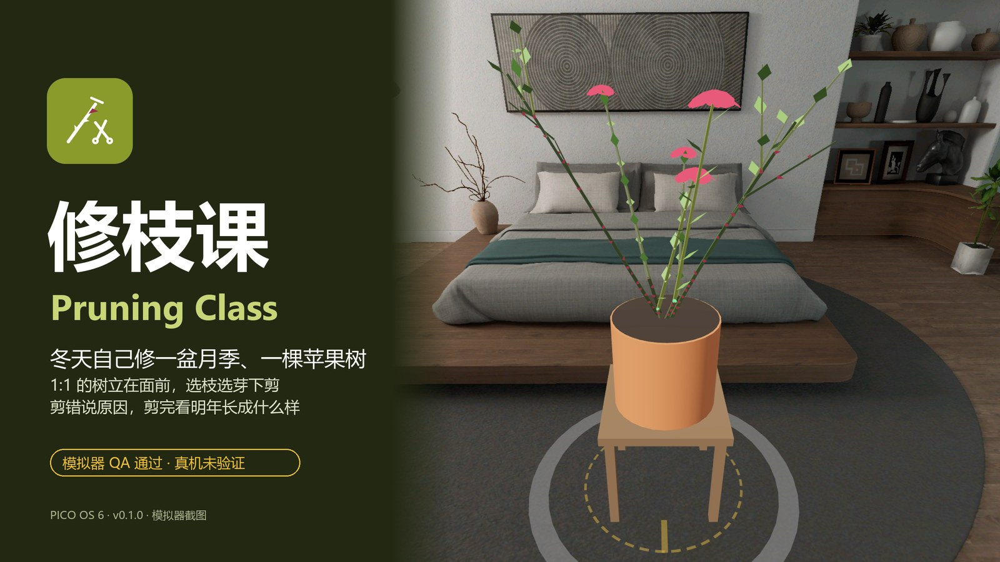
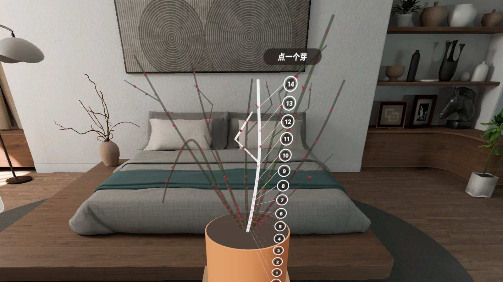
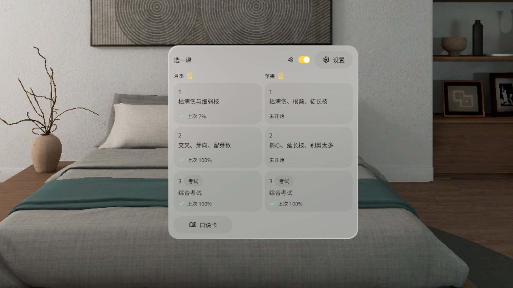
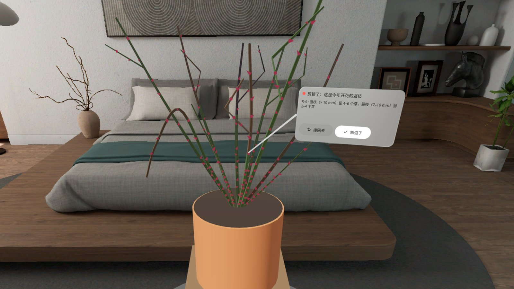
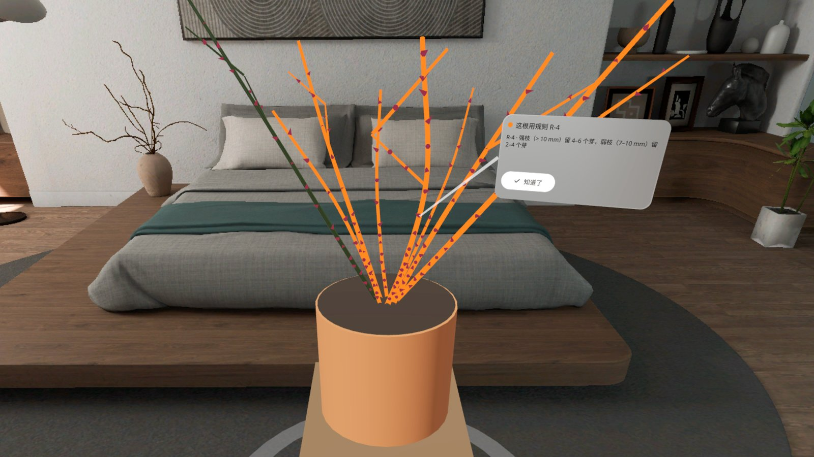
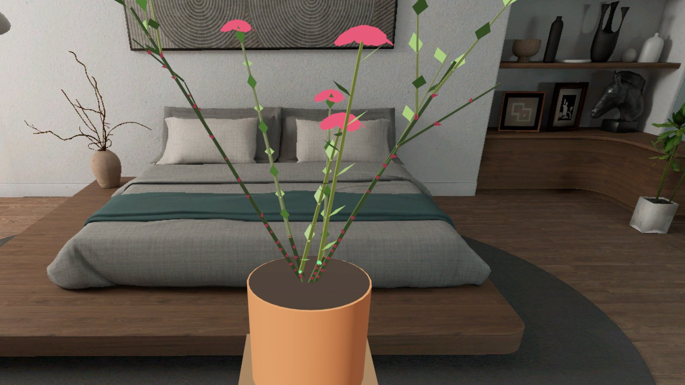
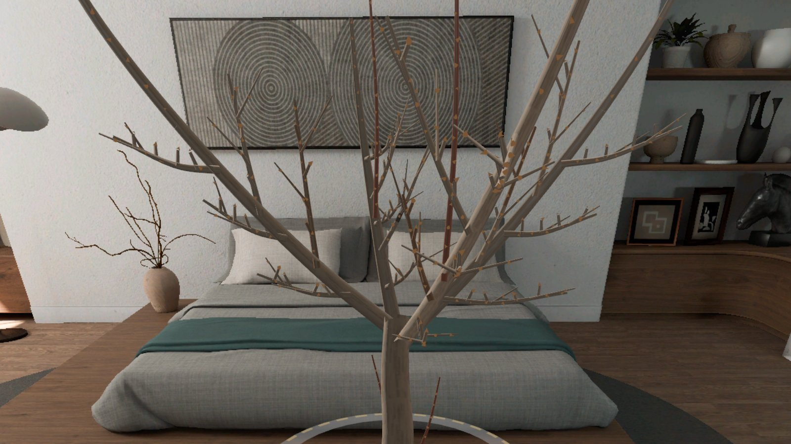

# 修枝课 Pruning Class

> **v0.1.0 · 预发布 · 模拟器 QA 通过，真机未验证**（Pre-release · passed emulator QA, not yet verified on a headset）



[中文](#中文) · [English](#english)

---

## 中文

冬天自己修一盆月季、一棵苹果树。PICO OS 6 混合现实应用：一盆 1:1 的休眠期月季（放在 0.40 m 花架上）或一棵 1:1 的矮化苹果树立在你面前。你原地站着，用摇杆或面板按钮把树转过来看；点一根枝，枝上的芽编号亮起，再点一个芽就在它上方剪一刀。剪错了，剪口旁的解说卡告诉你为什么；剪完看成绩，再切到「明年」，看你这样剪，明年这棵树长成什么样。

- **两种树各 3 课**：月季（枯病伤与细弱枝 → 交叉、芽向、留芽数 → 综合考试）；苹果（枯病伤、根蘖、徒长枝 → 树心、延长枝、别剪太多 → 综合考试）。第 3 课是不给提示的考试
- **选枝选芽下剪**：芽梯给每个芽编号，剪口自动吸附到外向芽上方；芽眼放大默认开
- **剪错有解说**：练习课每一刀即时判，讲清楚违反了哪条规则，可以接回去
- **成绩 + 明年**：剪对几根、误剪几根、去除量；「你的明年」和「标准明年」对比，满分时开出花
- **提示开关**：该剪的枝整根染橙色；口诀卡随时可看
- 树站在真实地面上（扫不到地面 5 秒后用估算地面，可在设置里调）；拖地面把手挪树，「叫回面前」一键回到正前方
- 中英双语，不联网，不需要账号

### 截图（模拟器，中文界面）

| | |
|---|---|
|  选中一根枝：芽梯给每个芽编号，「点一个芽」 |  选课：月季、苹果各 3 课，带上次成绩 |
|  剪错了：解说卡说明原因，可接回去 |  提示开：该剪的枝整根染橙色 |
|  标准明年：剪对了，月季开花 |  苹果课：开心形矮化苹果树立在地面种植圈里 |

截图来自 PICO 模拟器（High Definition 2560），状态用调试广播定住拍摄。演示视频（Release 附件 `PruningClass-demo-1080p.mp4`）是模拟器上由调试输入驱动的演示，**非真实手势录像**，无声。

### 安装

```bash
adb install -r PruningClass-v0.1.0.apk
pico-cli app launch io.embodit.pruningclass
```

APK 在 [Release v0.1.0](https://github.com/kejing-dev/PruningClass/releases/tag/v0.1.0)。需要 PICO OS 6（Spatial SDK 6.1.9，minSdk 35）。

### 真机未验证

模拟器上过了三道门禁（无 Material 组件、启动 60 秒无崩溃 / ANR、22 / 23 个状态截图核对），核心流程用模拟器捏合真实走通（选枝 → 点芽 → 剪 → 解说 → 剪完了 → 你的明年）。下面这些只有戴上头显才能确认：

- 摇杆左右转树、前后推远拉近、上下移芽光标 + 扳机（S18 转树状态没有截图：模拟器的手柄追踪不可用）
- 重新放树时的手柄射线幽灵
- 真手捏合点枝的命中宽容、透视下的面板对比度、音效在 1–3 米外够不够响
- 真机平面检测的时机，以及估算地面是否贴合

### 已知问题（不挡用）

1. 「准备中」只持续约 1.1 秒，模拟器上面板还没画出来就切到了选课页。
2. 抬头 30° 冷启动时选课页在视野下沿，要低头才能看全。
3. 5 秒内没扫到地面时按头高 −1.60 m 估算地面，模拟器上偏低，可在设置「地面高度」里调。
4. 课中进度在进程被系统杀掉后不恢复（成绩和结业记录保留）。
5. 芽梯最下面的「✕ 基部」环靠近盆口，偶尔会点到旁边的枝。
6. 模拟器上地面把手的拖动增益偏大。
7. 玻璃面板刚打开时下半截可能黑 30–40 秒后才画全（平台问题，已反馈）。
8. 练习课的解说卡 8 秒后自动淡出，成绩页里可以补看原因。

### 开发

Kotlin · PICO Spatial SDK 6.1.9 · 一个 Mixed Stage。结构、调试广播、截图脚本见 [AGENTS.md](AGENTS.md)。树皮、叶、花都是程序生成，不带图片素材；字体 Noto Sans / Noto Sans SC（SIL OFL 1.1，见 `third_party/`）。修剪规则参考 RHS（英国皇家园艺学会）的月季与苹果冬季修剪指南。

---

## English

Learn to prune a rose bush and an apple tree before winter. A PICO OS 6 mixed-reality app: a life-size dormant hybrid tea rose (on a 0.40 m plant stand) or a life-size dwarf apple tree stands in front of you. Stay where you are and turn the tree with the stick or the panel buttons. Point at a branch and its buds light up with numbers; point at a bud to cut just above it. A wrong cut gets a card next to it explaining why. Press Done for your score, then switch to Next year to see what your pruning grows into.

- **Two plants, three lessons each**: rose (dead wood and thin stems → crossing, bud direction, bud count → exam); apple (dead wood, suckers, water shoots → open centre, leaders, don't over-prune → exam). Lesson 3 is an exam with no hints
- **Pick a branch, pick a bud, cut**: the bud ladder numbers every bud and the cut snaps just above an outward bud; bud zoom is on by default
- **Explained mistakes**: practice lessons judge every cut at once, name the rule it broke, and let you undo
- **Score + next year**: correct cuts, wrong cuts, amount removed; compare "your next year" with the model answer — a perfect prune flowers
- **Hints**: branches that must go turn orange; the rules card is always available
- The tree stands on the real floor (an estimated floor after 5 s if none is found, adjustable in Settings); drag the floor handle to move it, "Bring it back" puts it in front of you again
- Chinese and English, offline, no account

### Screenshots

See the table above (Chinese UI on the PICO emulator, High Definition 2560, states pinned with debug broadcasts). The demo video in the release (`PruningClass-demo-1080p.mp4`) is driven by debug input on the emulator — **not a recording of real hand gestures** — and has no sound.

### Install

```bash
adb install -r PruningClass-v0.1.0.apk
pico-cli app launch io.embodit.pruningclass
```

Get the APK from [Release v0.1.0](https://github.com/kejing-dev/PruningClass/releases/tag/v0.1.0). Requires PICO OS 6 (Spatial SDK 6.1.9, minSdk 35).

### Not yet verified on a headset

It passed three emulator gates (no Material components, 60 s launch with no crash / ANR, 22 of 23 states captured and checked), and the core loop was walked through with real emulator pinches. Only a headset can confirm: stick turning, push / pull and the bud cursor (the turn-tree state has no screenshot because emulator controller tracking is unavailable); the controller-ray ghost when re-placing the tree; real-hand pinch tolerance, panel contrast over passthrough and sound level at 1–3 m; real floor detection timing and the estimated-floor fallback.

### Known issues (non-blocking)

1. "Loading" lasts ~1.1 s and the panel is not drawn before the lesson picker appears on the emulator.
2. Cold start while looking up 30°: the picker sits at the bottom of the view.
3. Without a detected floor within 5 s the floor is estimated at head height − 1.60 m (adjustable in Settings).
4. In-lesson cuts are not restored if the system kills the process (scores are kept).
5. The "✕ base" ring near the pot rim can occasionally hit a neighbouring branch.
6. Floor-handle drag gain is high on the emulator.
7. Glass panels may show a black lower half for 30–40 s after opening (platform issue, reported).
8. Practice explanation cards fade after 8 s; the score page lists the reasons again.

### Development

Kotlin · PICO Spatial SDK 6.1.9 · one Mixed Stage. See [AGENTS.md](AGENTS.md) for structure, debug broadcasts and screenshot scripts. Bark, leaves and flowers are generated in code (no image assets). Fonts: Noto Sans / Noto Sans SC (SIL OFL 1.1, `third_party/`). Pruning rules follow the RHS winter pruning guides for roses and apples.
