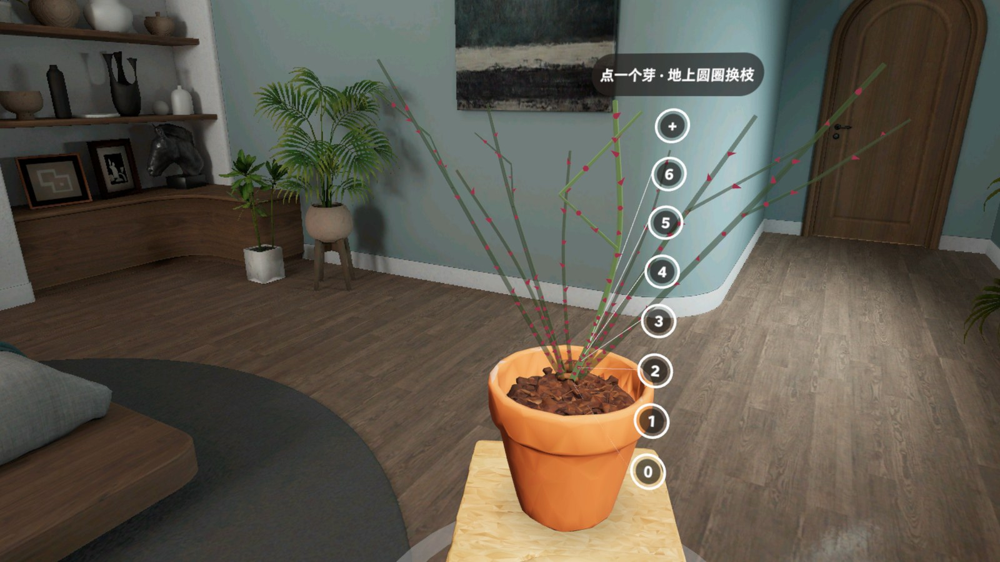
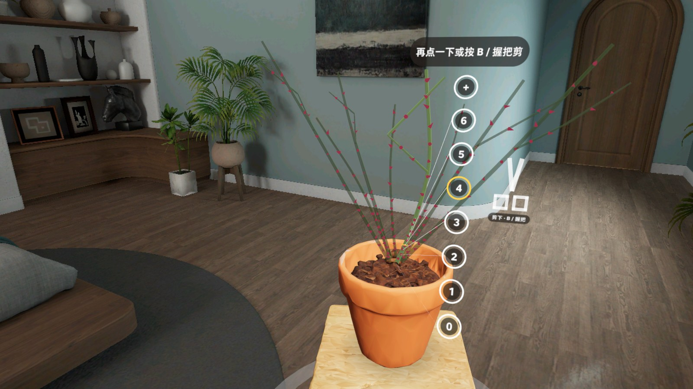
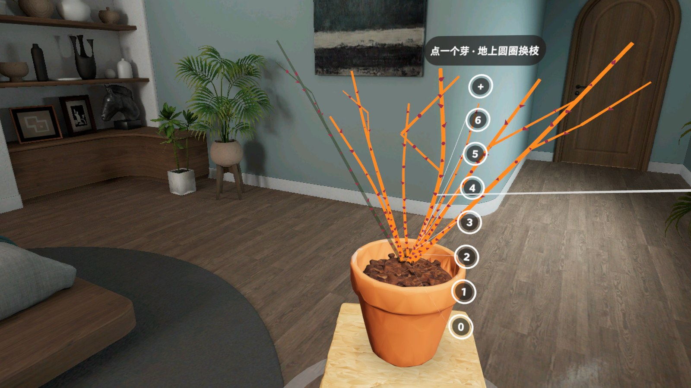
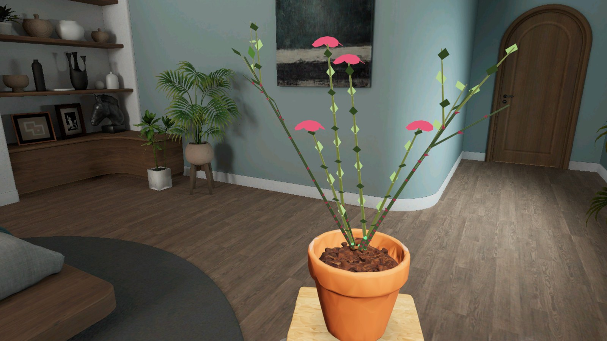
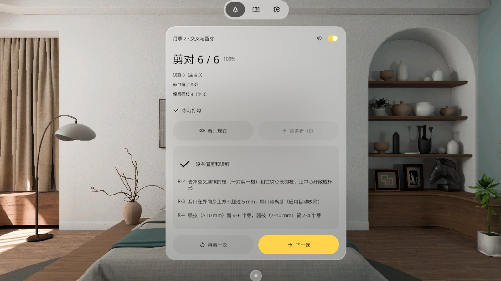
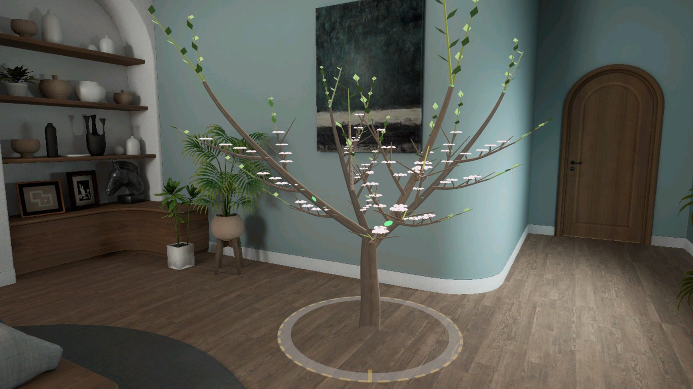

# 修枝课 Pruning Class

> **v0.1.8 · 正式发布**：选中的枝保留本色（不再整根变白）；选中后直接点另一根枝就换选；只有系统射线一条；[重置本课] 有剪口时先确认。模拟器 QA 第 7 轮通过，已装头显、待戴上验收。
> **v0.1.8 release**: the selected cane keeps its own colour (no more white); tap another cane to switch; one system ray only; [Reset lesson] asks first. Passed emulator QA round 7; installed on a headset, not yet checked by a person wearing it.

**安装 / Install**（APK 在 [Release v0.1.8](https://github.com/kejing-dev/PruningClass/releases/tag/v0.1.8)）：

```bash
adb install -r PruningClass-v0.1.8.apk
pico-cli app launch io.embodit.pruningclass
```

Release 里的 `PruningClass-v0.1.8.apk` 是 `assembleRelease` 出的**未签名**包（上架用，平台托管签名）；直接装头显要先签名，或在本机 `./gradlew assembleDebug` 后装 `app/build/outputs/apk/debug/app-debug.apk`。
The release APK is an **unsigned** `assembleRelease` build (for store submission, signed by the platform); to sideload, sign it first or build `./gradlew assembleDebug` and install the debug APK.

头显上如果装过别的电脑签名的旧版、报 `INSTALL_FAILED_UPDATE_INCOMPATIBLE`，先 `adb uninstall io.embodit.pruningclass` 再装。
If an older build signed on another machine is installed and you get `INSTALL_FAILED_UPDATE_INCOMPATIBLE`, run `adb uninstall io.embodit.pruningclass` first.


[中文](#中文) · [English](#english)

---

## 中文

冬天自己修一盆月季、一棵苹果树。PICO OS 6 混合现实应用：一盆 1:1 的休眠期月季（放在花架上）或一棵 1:1 的矮化苹果树立在你面前的真实地面上。点一根枝，旁边出现编号的芽环；点一个芽环，剪刀幽灵对准那个芽，再点一下（或按 B / 握把）就剪下去。练习课剪错了有解说卡讲原因；剪完看成绩，再切到「你的明年」和「标准明年」，看你这样剪明年长成什么样。

- **两种树各 3 课**：月季（枯病伤与细弱枝 → 交叉、芽向、留芽数 → 综合考试）；苹果（枯病伤、根蘖、徒长枝 → 树心、延长枝、别剪太多 → 综合考试）。第 3 课是不给提示的考试
- **芽环大、好点**：每个芽环 ≥ 4.5 cm（≥ 2.3°）、隔开 ≥ 2 cm，一页 7 个，「更多」翻页；几根枝挨得太近时先出字母环，点字母选枝
- **选中不盖颜色**：选中的枝保留树皮本色和枯 / 病 / 提示色，只轻微提亮（≤ 20 %），旁边的芽环和提示卡表示选中
- **换枝不用按钮**：选中一根枝时直接点另一根就换；点地上的圆圈或按 Y / X 退出
- **控制窗**：系统原生窗口，三个页签（修枝 / 口诀卡 / 设置）。修剪页只有 [撤销] [剪完了] [提示] [转 45°]，按钮 64 dp、间距 16 dp
- **成绩页**：剪对几根、误剪几根、去除量；一个键在「现在 / 你的明年 / 标准明年」之间切换，[逐条看] 列出每一刀
- **设置**里有「怎么操作」：选枝、选芽、剪下、换枝、转树、挪树、剪完了，每项写手和手柄两种做法
- 树站在真实地面上，捏住地上的圆圈拖动挪树；中英双语，不联网，不需要账号

### 截图（模拟器，中文界面，v0.1.8）

| | |
|---|---|
|  选中一根枝：保留本色，编号芽环 |  点了芽环：剪刀幽灵对准，「再点一下或按 B / 握把剪」 |
|  提示开：该剪的枝标成提示橙 |  标准明年：剪对了，月季开花 |
|  成绩页：剪对 6 / 6，看明年、逐条看、下一课 |  苹果考试剪完：「你的明年」开满花 |

截图全部是 v0.1.8 在 PICO 模拟器（High Definition 2560）上拍的，调试广播摆状态。演示视频（Release 附件 `PruningClass-demo-v0.1.8.mp4`）是**模拟器演示，调试输入驱动；非真实手势录像**，无声。

### 真机未验证

模拟器 QA 第 7 轮通过：无 Material 组件、启动 60 秒无崩溃 / ANR；选中高亮（保留本色）、换枝、[重置本课] 确认都回归过。v0.1.8 已装到头显，还没人戴上看。下面这些只有戴上头显才能确认：

- **射线**：应用不再自己画射线，按设计只剩系统那一条——**请先看这一项**
- 手柄 B / 握把剪、Y / X 退出、摇杆转树，拖动手感、眼动精度
- 真机平面检测的时机和估算地面是否贴合

### 已知问题

1. 射线真机未验（见上）。
2. 已选枝的芽环正好挡在别的枝尖前时，点那里会点到芽环而不是换枝（QA #7：7 次里 2 次）。
3. 剪刀幽灵还是方块拼的。
4. 字母环和它对应的枝不够清楚。
5. 捏合偶尔没收到点击（模拟器实测 4 / 84）。
6. 修剪页常驻一行说明文字。
7. [转 45°] 只能顺时针，反方向用摇杆。
8. 控制窗和树隔约 63°，要转头。
9. 「明年」视图里的标签会互相叠。

### 开发

Kotlin · PICO Spatial SDK 6.1.9。结构、调试广播、截图脚本见 [AGENTS.md](AGENTS.md)。树皮、叶、花都是程序生成，不带图片素材；字体 Noto Sans / Noto Sans SC（SIL OFL 1.1，见 `third_party/`）。修剪规则参考 RHS（英国皇家园艺学会）的月季与苹果冬季修剪指南。

---

## English

Learn to prune a rose bush and an apple tree before winter. A PICO OS 6 mixed-reality app: a life-size dormant hybrid tea rose (on a plant stand) or a life-size dwarf apple tree stands on the real floor in front of you. Tap a branch and numbered bud rings appear beside it; tap a ring and a scissors ghost lines up on that bud; tap again (or press B / grip) to cut. In practice lessons a wrong cut gets a card explaining why. When you are done, see your score, then switch between "your next year" and "model next year" to see what your pruning grows into.

- **Two plants, three lessons each**: rose (dead wood and thin stems → crossing, bud direction, bud count → exam); apple (dead wood, suckers, water shoots → open centre, leaders, don't over-prune → exam). Lesson 3 is an exam with no hints
- **Big bud rings**: each ring ≥ 4.5 cm (≥ 2.3°) with ≥ 2 cm gaps, 7 to a page with "more"; when branches are close together, letter rings come first and you pick the branch by letter
- **The selection keeps the colour**: the selected cane keeps its bark / disease / hint colour with a slight lift; the bud rings and tooltip show the selection
- **Switch branches without a button**: with a branch selected, tap another one; tap the circle on the floor or press Y / X to leave
- **Control window**: a native system window with three tabs (Lesson / Rule card / Settings). The lesson page has only [Undo] [Done] [Hints] [Turn 45°], 64 dp buttons with 16 dp gaps
- **Results**: correct cuts, wrong cuts, amount removed; one button cycles now / your next year / model next year, and [Review] goes through every cut
- **Settings → How to**: pick a branch, pick a bud, cut, switch branch, turn the tree, move the tree, done — each with the hand and the controller way
- The tree stands on the real floor; pinch the circle on the floor and drag to move it. Chinese and English, offline, no account

### Screenshots

See the table above (Chinese UI, all taken on v0.1.8 on the PICO emulator, High Definition 2560, states set by debug broadcasts). The demo video in the release (`PruningClass-demo-v0.1.8.mp4`) is an emulator demo driven by debug input — **not a recording of real hand gestures** — and has no sound.

### Not yet verified on a headset

It passed emulator QA round 7: no Material components, 60 s launch with no crash / ANR; the selection highlight (own colour), switching and the [Reset lesson] confirm re-tested. v0.1.8 is installed on a headset but nobody has worn it yet. Only a headset can confirm:

- **The ray**: the app no longer draws its own ray, so only the system one should show — **check this first**
- B / grip to cut, Y / X to leave, stick to turn the tree, drag feel, eye-tracking precision
- Real floor detection timing and whether the estimated floor fits

### Known issues

1. The ray is not verified on a headset (see above).
2. When the selected cane's bud rings sit right in front of another cane's tip, tapping there hits the ring instead of switching (QA #7: 2 of 7).
3. The scissors ghost is still built from boxes.
4. Letter rings do not show clearly which branch they belong to.
5. A pinch occasionally does not register as a tap (4 / 84 on the emulator).
6. The lesson page keeps one line of instructions on screen.
7. [Turn 45°] only turns clockwise; use the stick for the other way.
8. The control window is about 63° away from the tree, so you have to turn your head.
9. Labels overlap in the next-year view.

### Development

Kotlin · PICO Spatial SDK 6.1.9. See [AGENTS.md](AGENTS.md) for structure, debug broadcasts and screenshot scripts. Bark, leaves and flowers are generated in code (no image assets). Fonts: Noto Sans / Noto Sans SC (SIL OFL 1.1, `third_party/`). Pruning rules follow the RHS winter pruning guides for roses and apples.
