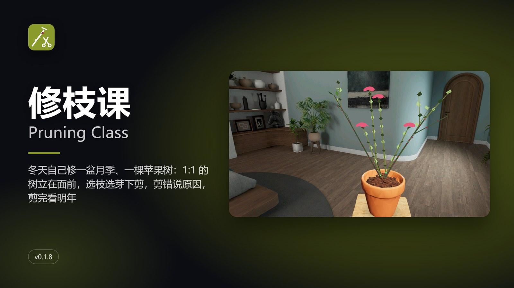
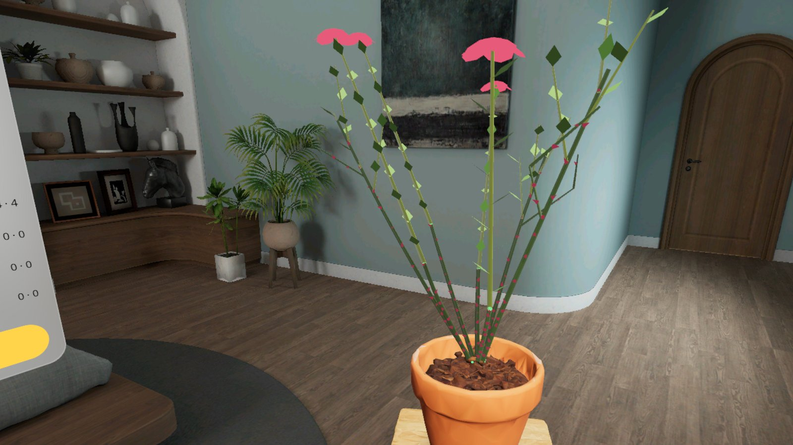
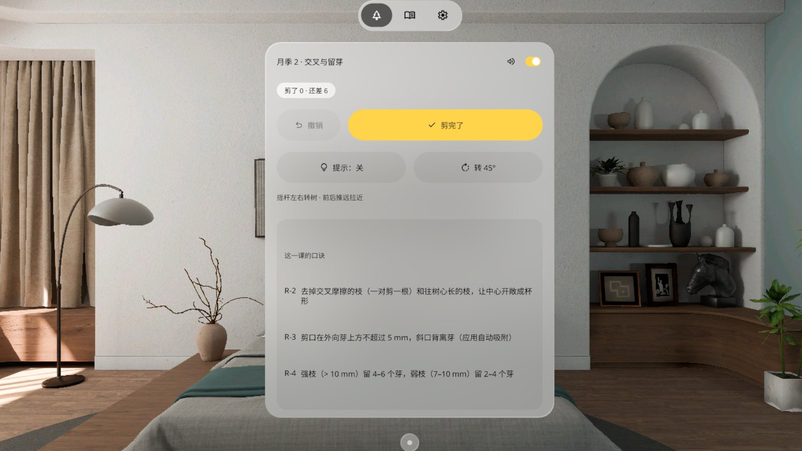
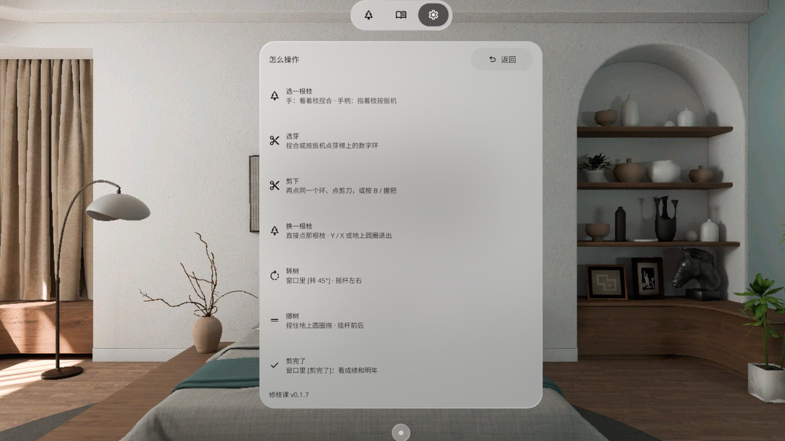

# 修枝课 Pruning Class

> **v0.1.8 · 研发版（待 QA）**：选中的枝保留本色（不再整根变白），其余枝淡化但带标记的不淡（Build for QA · the selected branch keeps its own colour）

**安装 / Install**（APK 在 [Release v0.1.7](https://github.com/kejing-dev/PruningClass/releases/tag/v0.1.7)）：

```bash
adb install -r pruning-class-v0.1.7-debug.apk
pico-cli app launch io.embodit.pruningclass
```

头显上如果装过别的电脑签名的旧版、报 `INSTALL_FAILED_UPDATE_INCOMPATIBLE`，先 `adb uninstall io.embodit.pruningclass` 再装。
If an older build signed on another machine is installed and you get `INSTALL_FAILED_UPDATE_INCOMPATIBLE`, run `adb uninstall io.embodit.pruningclass` first.



[中文](#中文) · [English](#english)

---

## 中文

冬天自己修一盆月季、一棵苹果树。PICO OS 6 混合现实应用：一盆 1:1 的休眠期月季（放在花架上）或一棵 1:1 的矮化苹果树立在你面前的真实地面上。点一根枝，旁边出现编号的芽环；点一个芽环，剪刀幽灵对准那个芽，再点一下（或按 B / 握把）就剪下去。练习课剪错了有解说卡讲原因；剪完看成绩，再切到「你的明年」和「标准明年」，看你这样剪明年长成什么样。

- **两种树各 3 课**：月季（枯病伤与细弱枝 → 交叉、芽向、留芽数 → 综合考试）；苹果（枯病伤、根蘖、徒长枝 → 树心、延长枝、别剪太多 → 综合考试）。第 3 课是不给提示的考试
- **芽环大、好点**：每个芽环 ≥ 4.5 cm（≥ 2.3°）、隔开 ≥ 2 cm，一页 7 个，「更多」翻页；几根枝挨得太近时先出字母环，点字母选枝
- **选中不盖颜色**：选中的枝保留树皮本色和枯 / 病 / 提示色，只轻微提亮（≤ 20 %），旁边的芽环和提示卡表示选中
- **换枝不用按钮**：选中一根枝时直接点另一根就换；点地上的圆圈或按 Y / X 退出
- **控制窗**：系统原生窗口，三个页签（修枝 / 口诀卡 / 设置）。修剪页只有 [撤销] [剪完了] [提示] [转 45°]，按钮 64 dp、间距 16 dp
- **成绩页**：剪对几根、误剪几根、去除量；一个键在「现在 / 你的明年 / 标准明年」之间切换，[逐条看] 列出每一刀
- **设置**里有「怎么操作」：选枝、选芽、剪下、换枝、转树、挪树、剪完了，每项写手和手柄两种做法
- 树站在真实地面上，捏住地上的圆圈拖动挪树；中英双语，不联网，不需要账号

### 截图（模拟器，中文界面，v0.1.7）

| | |
|---|---|
|  选中一根枝：编号芽环，「点一个芽」 |  点了芽环：剪刀幽灵对准，「再点一下或按 B / 握把剪」 |
|  标准明年：剪对了，月季开花 |  修剪页：四个大按钮 + 这一课的口诀 |
|  成绩页：剪对 6 / 6，看明年、逐条看 |  设置 → 怎么操作：手和手柄的做法 |

截图来自 PICO 模拟器（High Definition 2560）：前三张是 v0.1.7 演示录像里的画面和同一轮的截屏，后三张是 QA 第 6 轮（v0.1.7）的窗口截图。演示视频（Release 附件 `pruning-class-v0.1.7-demo.mp4`）是**原生模拟器演示，调试输入驱动；非真实手势录像**，无声。

### 真机未验证

模拟器 QA 第 6 轮通过：无 Material 组件、启动 60 秒无崩溃 / ANR；芽环、字母环、剪刀用射线和眼手捏合各回归一遍 0 次点错；换枝、种植位置、拖动都回归过。下面这些只有戴上头显才能确认：

- **射线**：应用不再自己画射线，按设计每个手柄只剩系统那一条。但 v0.1.0 在头显上，这个 Stage 里看不到系统射线，所以现在可能每手柄一条，也可能一条都没有——**请先看这一项**
- 手柄 B / 握把剪、Y / X 退出、摇杆转树，拖动手感、眼动精度
- 真机平面检测的时机和估算地面是否贴合

### 已知问题

1. 射线真机未验（见上）。
2. 剪刀幽灵还是方块拼的。
3. 字母环和它对应的枝不够清楚。
4. 捏合偶尔没收到点击（模拟器实测 4 / 84）。
5. 修剪页常驻一行说明文字。
6. [转 45°] 只能顺时针，反方向用摇杆。
7. 控制窗和树隔约 63°，要转头。
8. 「明年」视图里的标签会互相叠。

### 开发

Kotlin · PICO Spatial SDK 6.1.9。结构、调试广播、截图脚本见 [AGENTS.md](AGENTS.md)。树皮、叶、花都是程序生成，不带图片素材；字体 Noto Sans / Noto Sans SC（SIL OFL 1.1，见 `third_party/`）。修剪规则参考 RHS（英国皇家园艺学会）的月季与苹果冬季修剪指南。

---

## English

Learn to prune a rose bush and an apple tree before winter. A PICO OS 6 mixed-reality app: a life-size dormant hybrid tea rose (on a plant stand) or a life-size dwarf apple tree stands on the real floor in front of you. Tap a branch and numbered bud rings appear beside it; tap a ring and a scissors ghost lines up on that bud; tap again (or press B / grip) to cut. In practice lessons a wrong cut gets a card explaining why. When you are done, see your score, then switch between "your next year" and "model next year" to see what your pruning grows into.

- **Two plants, three lessons each**: rose (dead wood and thin stems → crossing, bud direction, bud count → exam); apple (dead wood, suckers, water shoots → open centre, leaders, don't over-prune → exam). Lesson 3 is an exam with no hints
- **Big bud rings**: each ring ≥ 4.5 cm (≥ 2.3°) with ≥ 2 cm gaps, 7 to a page with "more"; when branches are close together, letter rings come first and you pick the branch by letter
- **Switch branches without a button**: with a branch selected, tap another one; tap the circle on the floor or press Y / X to leave
- **Control window**: a native system window with three tabs (Lesson / Rule card / Settings). The lesson page has only [Undo] [Done] [Hints] [Turn 45°], 64 dp buttons with 16 dp gaps
- **Results**: correct cuts, wrong cuts, amount removed; one button cycles now / your next year / model next year, and [Review] goes through every cut
- **Settings → How to**: pick a branch, pick a bud, cut, switch branch, turn the tree, move the tree, done — each with the hand and the controller way
- The tree stands on the real floor; pinch the circle on the floor and drag to move it. Chinese and English, offline, no account

### Screenshots

See the table above (Chinese UI on the PICO emulator, High Definition 2560; the first three from the v0.1.7 demo session, the last three from QA round 6 on v0.1.7). The demo video in the release (`pruning-class-v0.1.7-demo.mp4`) is an emulator demo driven by debug input — **not a recording of real hand gestures** — and has no sound.

### Not yet verified on a headset

It passed emulator QA round 6: no Material components, 60 s launch with no crash / ANR, bud rings, letter rings and scissors re-tested with ray and eye-hand pinch with zero misses, branch switching, placement and dragging re-tested. Only a headset can confirm:

- **The ray**: the app no longer draws its own ray, so each controller should show just the system one. But on the headset v0.1.0 showed no system ray in this Stage, so now there may be one ray per controller or none at all — **check this first**
- B / grip to cut, Y / X to leave, stick to turn the tree, drag feel, eye-tracking precision
- Real floor detection timing and whether the estimated floor fits

### Known issues

1. The ray is not verified on a headset (see above).
2. The scissors ghost is still built from boxes.
3. Letter rings do not show clearly which branch they belong to.
4. A pinch occasionally does not register as a tap (4 / 84 on the emulator).
5. The lesson page keeps one line of instructions on screen.
6. [Turn 45°] only turns clockwise; use the stick for the other way.
7. The control window is about 63° away from the tree, so you have to turn your head.
8. Labels overlap in the next-year view.

### Development

Kotlin · PICO Spatial SDK 6.1.9. See [AGENTS.md](AGENTS.md) for structure, debug broadcasts and screenshot scripts. Bark, leaves and flowers are generated in code (no image assets). Fonts: Noto Sans / Noto Sans SC (SIL OFL 1.1, `third_party/`). Pruning rules follow the RHS winter pruning guides for roses and apples.
